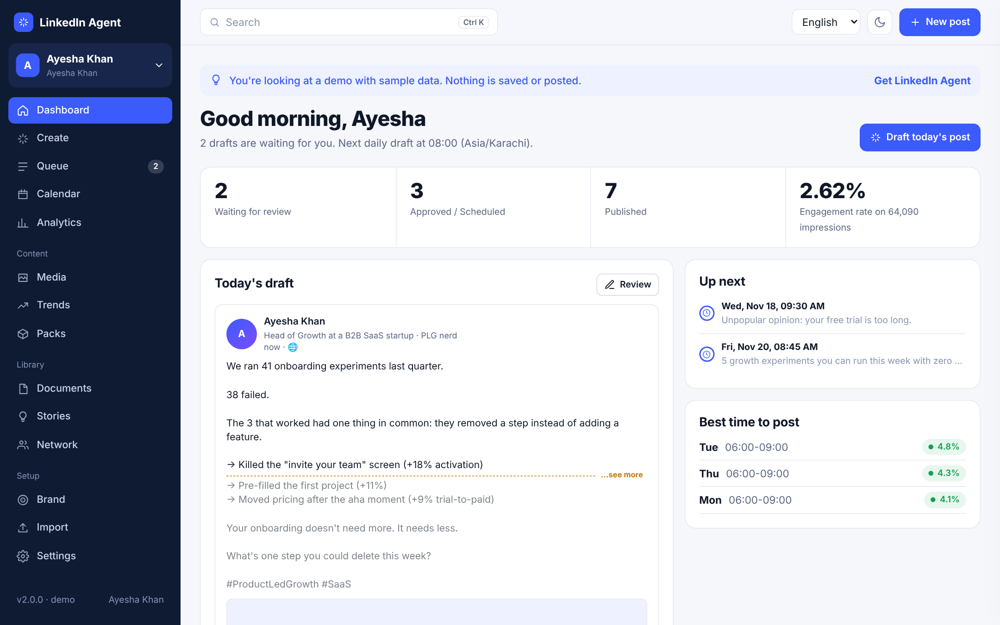

<div align="center">


# LinkedIn Agent

**Your LinkedIn, written for you. Posted only when you say so.**

An open-source AI agent that drafts a post every morning in your voice, rewrites your profile, builds your resume and publishes through LinkedIn's official API once you approve. You can use any AI model. It ships as a desktop app, a web portal, Docker, an MCP server and a Claude skill.

[Website](https://jrnoorbaloch.github.io/linkedin-agent/) · [Download](https://jrnoorbaloch.github.io/linkedin-agent/download.html) · [Live demo](https://jrnoorbaloch.github.io/linkedin-agent/demo/) · [Screens](https://jrnoorbaloch.github.io/linkedin-agent/screens.html) · [Docs](https://jrnoorbaloch.github.io/linkedin-agent/docs.html)



</div>

## What's new in v2

- **Desktop app:** a Windows installer, a macOS app and a Linux build. Installers are built automatically for every release.
- **New interface:**
  - an approval board
  - a post editor with a live LinkedIn preview that shows where "see more" cuts
  - a drag-to-reschedule calendar
  - a command palette
  - dark mode
  - **5 languages** (English, Urdu, Hindi, Arabic, Spanish), with right-to-left layouts for Urdu and Arabic
- **One-drop setup:** import LinkedIn's own data export. It fills your profile, voice and post history.
- **8 persona packs:** students, job seekers, developers, freelancers, sales, founders, doctors/teachers/experts, and recruiters.
- **39 skills,** 11 of them new: trend ideas, video script, image prompt, evergreen recycler, project showcase, open-to-work, recruiter outreach, social selling, case study, expert explainer and headline A/B.
- **Images and PDF carousels:** posted with LinkedIn's Images and Documents APIs.
- **Analytics:** import LinkedIn's analytics export to get a weekday × hour heatmap, best posting slots, and results by hook and pillar.
- **Teams:** workspaces for several accounts and clients, admin/editor/reviewer roles, and signed client review links.
- **Phone approvals:** approve from Telegram buttons or WhatsApp replies. Slack, webhooks (Zapier/Make/n8n), a calendar subscription and CSV export are also available.
- **Distribution:** a Docker image on GHCR, one-click Render and Railway configs, and CI.

## Install

| | |
|---|---|
| **Windows / macOS / Linux** | [Download the app](https://jrnoorbaloch.github.io/linkedin-agent/download.html) |
| **Python 3.10+** | `pip install git+https://github.com/jrnoorbaloch/linkedin-agent` → `linkedin-agent serve` or `linkedin-agent-desktop` |
| **Docker** | `docker run -p 8787:8787 -v la-data:/data --env-file .env ghcr.io/jrnoorbaloch/linkedin-agent` |

Then follow [Install & set up](https://jrnoorbaloch.github.io/linkedin-agent/getting-started.html):

1. Connect a model.
2. Import your LinkedIn data.
3. Pick a pack.
4. [Create your LinkedIn app](https://jrnoorbaloch.github.io/linkedin-agent/linkedin-app.html) and connect it.

## Use it from Claude or any AI agent

- **Claude skill:** `skill/linkedin-agent/`. You can also [download the ZIP](docs/downloads/linkedin-agent-skill.zip) and upload it in Claude.
- **Subagent:** `agents/linkedin-agent.md` (for Claude Code).
- **MCP server:** `linkedin-agent mcp` exposes 25 tools. In Claude Code, run `claude mcp add linkedin-agent -- linkedin-agent mcp`.

## What LinkedIn's API allows

| Capability | Status |
|---|---|
| Post as yourself (text, image, PDF carousel) + first comment | ✅ Self-serve |
| Post as a Company Page | ✅ After Community Management API approval |
| Edit your profile | ❌ No API. The agent writes the copy and you paste it |
| Read analytics | ❌ Restricted. Import LinkedIn's export instead |
| DMs and connection requests | ❌ No API. The agent drafts them and you send them |

The agent doesn't scrape and doesn't drive a browser, so your account isn't put at risk.

## Development

```bash
pip install -e '.[dev,desktop]' && pytest -q
python tools/build_demo.py && python tools/build_docs.py     # regenerate docs/
pyinstaller packaging/linkedin-agent.spec --noconfirm       # desktop build
```

See [CONTRIBUTING.md](CONTRIBUTING.md). Releases are made by pushing a `v*` tag, which builds the installers, the Docker image and the Python packages.

## License

MIT. Not affiliated with or endorsed by LinkedIn Corporation.
