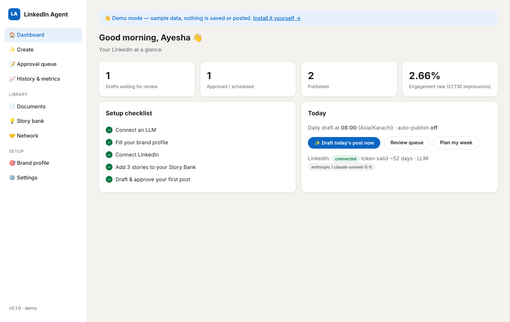

<div align="center">

# LinkedIn Agent

**Open-source AI agent for LinkedIn: daily posts, profile optimization, resumes and approval-gated publishing. Bring your own LLM.**

Web portal · MCP server · Claude skill & subagent

[Documentation](https://jrnoorbaloch.github.io/linkedin-agent/) · [Live UI demo](https://jrnoorbaloch.github.io/linkedin-agent/demo/) · [Getting started](https://jrnoorbaloch.github.io/linkedin-agent/getting-started.html) · [Skills](https://jrnoorbaloch.github.io/linkedin-agent/skills.html)



</div>

## What it does

- **Drafts a post every morning** from your content pillars and Story Bank, then waits for your approval.
- **Publishes through LinkedIn's official API**: posts plus an automatic first comment, and Company Pages once LinkedIn approves your app.
- **Works with any LLM**: OpenAI, Claude, Gemini, Groq, OpenRouter, DeepSeek, any OpenAI-compatible endpoint, or a local Ollama model.
- **28 skills**: post writer (20 hook formulas), humanizer, carousel, poll, article, repurposer, comment and reply drafter, connection notes, DMs, recommendations, profile optimizer, voice builder, story interviewer, resume (DOCX export), cover letter, job match, interview prep, skills gap, salary negotiation, Company Page posts, hiring posts, employee advocacy, weekly report and competitor analysis.
- **Approval-gated**: the API refuses to publish anything you haven't approved.
- **Private**: SQLite on your machine, with API keys and OAuth tokens encrypted at rest.

## Quick start

```bash
pip install git+https://github.com/jrnoorbaloch/linkedin-agent
linkedin-agent serve            # → http://localhost:8787
```

Or with Docker:

```bash
git clone https://github.com/jrnoorbaloch/linkedin-agent && cd linkedin-agent
cp .env.example .env            # add your LinkedIn app credentials
docker compose up -d
```

Then:

1. Create a LinkedIn developer app with the **Sign In with LinkedIn (OpenID Connect)** and **Share on LinkedIn** products.
2. Set the redirect URL to `http://localhost:8787/auth/linkedin/callback`.
3. Put the Client ID and Client Secret in `.env`.
4. In the portal, connect LinkedIn and your LLM, fill your brand profile, and draft your first post.

Full guide: [Getting started](https://jrnoorbaloch.github.io/linkedin-agent/getting-started.html).

## Use it from Claude or any AI agent

| | |
|---|---|
| **Claude skill** | `skill/linkedin-agent/`: one skill with 13 playbooks. Upload [`linkedin-agent-skill.zip`](docs/downloads/linkedin-agent-skill.zip) in Claude, or copy the folder to `~/.claude/skills/`. |
| **Subagent** | `agents/linkedin-agent.md`: a LinkedIn manager for Claude Code (daily post, weekly plan, profile overhaul, weekly review). |
| **MCP server** | `linkedin-agent mcp`, for Claude Desktop, Claude Code, Cursor or any MCP client. |

```json
{ "mcpServers": { "linkedin-agent": { "command": "linkedin-agent", "args": ["mcp"] } } }
```

## What LinkedIn's API allows

| Capability | Status |
|---|---|
| Post and first-comment as yourself | ✅ Self-serve (`w_member_social`) |
| Post as a Company Page | ✅ After Community Management API approval |
| Edit your profile | ❌ No API. The agent writes the copy and you paste it |
| Read post analytics | ❌ Restricted. Enter the numbers in History |
| DMs and connection requests | ❌ No API. The agent drafts and you send |

There is no scraping and no browser automation.

## Project layout

```
linkedin_agent/      core: skills registry, LLM client, LinkedIn API, scheduler, FastAPI, MCP server
  static/index.html  the web portal (single file)
skill/linkedin-agent Claude skill (SKILL.md + references + scripts)
agents/              Claude Code subagent
docs/                documentation site (GitHub Pages) + live demo
tools/               build scripts for the demo and docs
tests/               pytest suite
```

## Development

```bash
pip install -e '.[dev]' && pytest
python tools/build_demo.py && python tools/build_docs.py   # rebuild docs/
```

Add a skill by appending to `SKILLS` in `linkedin_agent/skills.py`. The portal, REST API and MCP server pick it up automatically.

## License

MIT. Not affiliated with or endorsed by LinkedIn Corporation.
